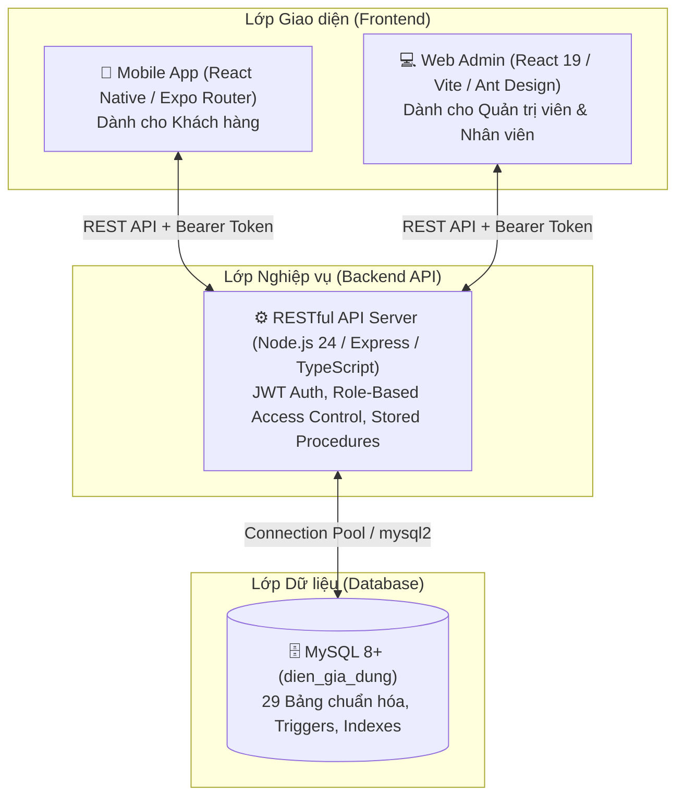

# ⚡ APPELECTRICSHOP - HỆ THỐNG QUẢN LÝ & KINH DOANH THIẾT BỊ ĐIỆN GIA DỤNG

> **Dự án:** ElectricShop Platform  
> **Kiến trúc:** 3 tầng đồng bộ (Backend API + Web Quản trị Admin + Mobile App Mua sắm)  
> **Trạng thái:** Toàn bộ chức năng đã hoàn thiện, cơ sở dữ liệu tối ưu chuẩn hóa 29 bảng, 100% kiểm thử pass.

---

## 📖 MỤC LỤC
1. [Giới thiệu Tổng quan Dự án](#1-giới-thiệu-tổng-quan-dự-án)
2. [Kiến trúc & Công nghệ Sử dụng](#2-kiến-trúc--công-nghệ-sử-dụng)
3. [Cơ sở Dữ liệu Chuẩn hóa (29 Bảng)](#3-cơ-sở-dữ-liệu-chuẩn-hóa-29-bảng)
4. [Các Phân hệ & Nghiệp vụ Nổi bật](#4-các-phân-hệ--nghiệp-vụ-nổi-bật)
   - [4.1. Phân hệ Web Admin (Vận hành & Quản trị)](#41-phân-hệ-web-admin-vận-hành--quản-trị)
   - [4.2. Phân hệ Mobile App (Khách hàng & Trải nghiệm)](#42-phân-hệ-mobile-app-khách-hàng--trải-nghiệm)
5. [Hướng dẫn Cài đặt & Khởi chạy Chi tiết](#5-hướng-dẫn-cài-đặt--khởi-chạy-chi-tiết)
6. [Danh sách Tài khoản Mẫu Đăng nhập](#6-danh-sách-tài-khoản-mẫu-đăng-nhập)
7. [Kiểm thử & Đảm bảo Chất lượng](#7-kiểm-thử--đảm-bảo-chất-lượng)

---

## 1. GIỚI THIỆU TỔNG QUAN DỰ ÁN

**ElectricShop** là hệ sinh thái thương mại điện tử chuyên biệt cho ngành thiết bị điện gia dụng (Tủ lạnh, Máy giặt, Điều hòa, Nồi cơm điện, Quạt điện, Tivi,...). Hệ thống giải quyết trọn vẹn bài toán vận hành thực tế:
- **Khách hàng** được trải nghiệm ứng dụng di động mượt mà, lựa chọn thông số kỹ thuật đa dạng theo từng biến thể sản phẩm, áp dụng voucher giảm giá thông minh, tham gia điểm danh chuỗi 30 ngày nhận quà và giới thiệu bạn bè nhận thưởng ví tích lũy.
- **Nhân viên & Quản trị viên** sở hữu công cụ quản trị web chuyên sâu với báo cáo kinh doanh đa chiều (chi tiết đơn hàng bán theo nhân viên, tồn kho thời gian thực, lịch sử nhập hàng), quản lý kho hàng, phân quyền tác vụ chi tiết và phát hành voucher linh hoạt (toàn sàn hoặc riêng cho từng tài khoản).

---

## 2. KIẾN TRÚC & CÔNG NGHỆ SỬ DỤNG

Hệ thống được xây dựng theo mô hình **3-Tier Architecture** tách biệt, bảo mật và hiệu năng cao:



### Chi tiết Công nghệ:
- **Backend (BE):**
  - Ngôn ngữ & Runtime: Node.js 24 LTS, TypeScript 5.8
  - Framework: Express 4.21
  - Cơ sở dữ liệu: MySQL 8+ với `mysql2/promise` (Connection Pooling)
  - Xác thực & Bảo mật: JWT (JSON Web Tokens), `bcryptjs`, quản lý phiên `auth_sessions`, phân quyền `staff_permissions`.
- **Web Quản trị (FE/admin):**
  - Ngôn ngữ & Build: TypeScript, Vite 6, React 19
  - UI Framework: Ant Design 5 (AntD)
  - Biểu đồ & Xuất file: Ant Design Charts, `exceljs` (xuất file báo cáo đa dạng định dạng Excel nhiều sheet).
- **Ứng dụng Di động (FE/Mobile):**
  - Nền tảng: React Native, Expo SDK 52, Expo Router v4
  - Styling: React Native Reanimated, Vector Icons, Lucide Icons
  - Quản lý phiên: AsyncStorage, Context API, Axios client.

---

## 3. CƠ SỞ DỮ LIỆU CHUẨN HÓA (29 BẢNG)

Database của hệ thống đã được tái cấu trúc và tinh gọn tối đa thành đúng **29 bảng** cốt lõi, xóa bỏ hoàn toàn các bảng dư thừa/trùng lặp mà vẫn đảm bảo 100% tính toàn vẹn và nghiệp vụ:

| Nhóm Nghiệp vụ | Bảng Dữ liệu | Mục đích & Ý nghĩa Nghiệp vụ |
|:---|:---|:---|
| **Người dùng & Phân quyền** | `tai_khoan` | Lưu thông tin người dùng, tài khoản đăng nhập, vai trò (`Admin`, `NhanVien`, `KhachHang`). |
| | `nhan_vien` | Lưu hồ sơ nhân sự: chức vụ, lương, ngày vào làm, thông tin liên hệ. |
| | `staff_permissions` | Quản lý ma trận phân quyền chi tiết cho nhân viên (`orders`, `catalog`, `inventory`, `reports`, `reviews`, `vouchers`, `contacts`). |
| | `auth_sessions` | Quản lý phiên đăng nhập hợp lệ, hỗ trợ refresh token xoay vòng và thu hồi token tức thì khi đổi mật khẩu. |
| **Sản phẩm & Thông số kỹ thuật** | `danh_muc` | Phân loại sản phẩm (Tủ lạnh, Quạt điện, Tivi, Máy giặt,...). |
| | `thuong_hieu` | Thương hiệu sản phẩm (Panasonic, Samsung, LG, Sony, Senko,...). |
| | `san_pham` | Thông tin gốc sản phẩm: mã code, tên, giá bán cơ sở, số lượng tồn kho, trạng thái. |
| | `san_pham_bien_the` | Biến thể sản phẩm (SKU, màu sắc, công suất, dung tích, giá bán riêng, tồn kho riêng). |
| | `hinh_anh_san_pham` | Bộ sưu tập hình ảnh chi tiết cho từng sản phẩm. |
| | `nhom_thong_so` | Nhóm thông số kỹ thuật (Thông tin cơ bản, Kích thước & năng lực, Điện năng, Công nghệ). |
| | `thong_so` | Danh mục thuộc tính thông số (Độ phân giải, Dung tích, Công suất, Số cánh quạt,...). |
| | `danh_muc_thong_so` | Cấu hình thông số bắt buộc/tùy chọn gắn theo từng danh mục thiết bị. |
| | `thong_so_san_pham` | Giá trị thông số thực tế của từng sản phẩm cụ thể. |
| **Bán hàng & Đơn hàng** | `gio_hang` | Giỏ hàng của từng tài khoản khách hàng. |
| | `chi_tiet_gio_hang` | Chi tiết mặt hàng trong giỏ (sản phẩm, biến thể được chọn, số lượng). |
| | `don_hang` | Đơn hàng: mã đơn, người nhận, địa chỉ, phương thức COD, trạng thái giao, mã voucher, phí ship, tổng tiền. |
| | `chi_tiet_don_hang` | Chi tiết sản phẩm trong đơn (giá mua lúc đặt, số lượng, biến thể). |
| | `dia_chi_giao_hang` | Sổ địa chỉ giao hàng của khách hàng (hỗ trợ đánh dấu địa chỉ mặc định). |
| | `checkout_requests` | Lưu snapshot thanh toán idempotency, chống đặt trùng lặp đơn hàng. |
| **Kho bãi & Vận hành** | `nhap_kho` | Lịch sử nhập hàng: nhân viên nhập, sản phẩm, biến thể, số lượng nhập, ghi chú, thời gian nhập. |
| **Voucher & Khuyến mãi** | `voucher` | Mã giảm giá cửa hàng: mã code, số tiền/tỷ lệ giảm, đơn tối thiểu, số lượt phát hành, thời hạn. |
| | `tai_khoan_voucher` | Quản lý voucher phát hành riêng/kích hoạt độc quyền cho số điện thoại/tài khoản khách hàng. |
| | `voucher_su_dung` | Lịch sử ghi nhận khách hàng đã sử dụng voucher (kiểm soát giới hạn lượt dùng mỗi người). |
| **Gamification & Giữ chân** | `lich_su_diem_danh` | Ghi nhận nhật ký điểm danh hàng ngày của khách hàng, tích lũy xu thưởng. |
| | `lich_su_moc_diem_danh`| Ghi nhận các mốc thưởng chuỗi điểm danh đặc biệt (mốc 7 ngày, 14 ngày, 30 ngày). |
| | `lich_su_gioi_thieu` | Ghi nhận quan hệ giới thiệu bạn bè bằng mã mời, cộng tiền thưởng & xu cho 2 bên. |
| **Tương tác & CSKH** | `danh_gia` | Đánh giá sao (1-5 sao) và nhận xét sản phẩm từ khách hàng đã mua và nhận hàng thành công. |
| | `lien_he` | Hộp thư hỗ trợ khách hàng, trạng thái xử lý và phản hồi từ nhân viên. |
| | `thong_bao` | Thông báo đẩy trong ứng dụng cho khách hàng (cập nhật đơn hàng, phản hồi liên hệ, quà tặng). |

---

## 4. CÁC PHÂN HỆ & NGHIỆP VỤ NỔI BẬT

### 4.1. Phân hệ Web Admin (Vận hành & Quản trị)

1. **Báo cáo Kinh doanh Đa chiều Chuyên sâu:**
   - **Báo cáo Đơn hàng bán chi tiết:** Thống kê tường minh từng dòng hàng: *Nhân viên nào bán/phụ trách, Khách hàng nào mua, Sản phẩm & Biến thể gì, Đơn giá bán, Số lượng đã bán*, và đặc biệt có cột **Số lượng tồn trong kho thực tế** ngay cạnh số lượng bán giúp theo dõi cung - cầu chuẩn xác.
   - **Báo cáo Nhập kho chi tiết:** Hiển thị *Nhân viên nào lập phiếu nhập, Nhập biến thể gì, Mã SKU nào, Số lượng nhập bao nhiêu, Thời gian nhập, Ghi chú đi kèm*.
   - **Báo cáo Doanh thu & Tồn kho:** Thống kê tổng quan doanh thu theo ngày/tháng/năm, danh sách sản phẩm bán chạy nhất, danh sách sản phẩm sắp hết hàng cần nhập bổ sung.
   - **Xuất file Excel chuyên nghiệp:** Hỗ trợ xuất dữ liệu ra file `.xlsx` định dạng đẹp mắt với nhiều tab sheet phục vụ kế toán và ban quản trị.
2. **Quản lý Voucher Nâng cao:**
   - Tạo mã giảm giá theo số tiền cố định (VNĐ) hoặc tỷ lệ phần trăm (%).
   - Cài đặt điều kiện: Giá trị đơn hàng tối thiểu, giới hạn tổng lượt dùng, giới hạn số lượt mỗi khách.
   - **Kích hoạt Voucher Riêng:** Hỗ trợ nhập **Số điện thoại** hoặc **Tên đăng nhập** để cấp mã giảm giá độc quyền cho khách hàng VIP hoặc khách hàng được bồi hoàn CSKH.
3. **Quản lý Sản phẩm, Biến thể & Thông số Kỹ thuật Động:**
   - Định nghĩa thông số kỹ thuật linh hoạt cho từng danh mục (ví dụ: Tivi có kích thước màn hình, độ phân giải; Quạt điện có số cánh, công suất).
   - Quản lý đa biến thể cho từng sản phẩm: mỗi biến thể có mã SKU, tên phân loại, giá bán và tồn kho riêng biệt.
4. **Quản lý Kho & Vận hành Đơn hàng:**
   - Phiếu nhập kho nhanh chóng, tự động cộng tồn kho vào sản phẩm/biến thể tương ứng.
   - Xử lý đơn hàng theo luồng chuẩn: *Chờ xác nhận -> Đã xác nhận -> Đang giao -> Đã giao (hoặc Đã hủy)*. Hủy đơn tự động hoàn kho an toàn nguyên vẹn.
5. **Phân quyền Nhân viên (Staff Permission Matrix):**
   - Phân chia nhiệm vụ cụ thể cho từng nhân viên: chỉ nhân viên được cấp quyền tương ứng mới thấy và thao tác được trên các tab chức năng.

---

### 4.2. Phân hệ Mobile App (Khách hàng & Trải nghiệm)

1. **Gamification - Bảng Điểm danh Chuỗi 30 Ngày Nhận quà:**
   - Giao diện trực quan 30 ngày điểm danh liên tục.
   - Mỗi ngày điểm danh nhận ngay **+100 Xu**.
   - Các mốc đặc biệt: **Mốc 7 ngày (+500 Xu), Mốc 14 ngày (+1.000 Xu + Voucher), Mốc 30 ngày (+3.000 Xu + Quà VIP)** với nút bấm nhận thưởng mượt mà.
2. **Mã Mời & Giới thiệu Bạn bè:**
   - Mỗi khách hàng sở hữu 1 mã giới thiệu riêng biệt.
   - Người mới đăng ký nhập mã mời sẽ nhận ngay **+50.000đ** vào ví quà tặng và **+500 Xu**. Người giới thiệu cũng nhận thưởng tương ứng khi bạn bè hoàn tất.
3. **Ví Xu Tích lũy & Kho Voucher:**
   - Hiển thị trực quan số dư Xu trong trang Tài khoản.
   - Trang danh sách voucher: hiển thị toàn bộ voucher công khai của shop và các voucher được tặng riêng cho tài khoản.
   - Nút sao chép mã hoặc áp dụng tự động ngay trong trang Giỏ hàng / Thanh toán.
4. **Mua sắm & Thanh toán An toàn:**
   - Chọn biến thể sản phẩm trực tiếp (màu sắc, dung tích, công suất) trước khi thêm vào giỏ hoặc Mua ngay.
   - Áp dụng mã giảm giá với cơ chế kiểm tra điều kiện tự động (báo rõ lý do nếu đơn chưa đủ giá trị tối thiểu).
   - Đặt hàng thanh toán khi nhận hàng (COD) với cơ chế bảo vệ giao dịch (Idempotency).
   - Theo dõi tiến trình đơn hàng, xem lại lịch sử và viết đánh giá 5 sao kèm nhận xét.

---

## 5. HƯỚNG DẪN CÀI ĐẶT & KHỞI CHẠY CHI TIẾT

### 5.1. Yêu cầu Môi trường
- **Node.js:** Phiên bản `v20.x` hoặc `v24.x LTS` (Khuyến nghị Node 24).
- **MySQL:** Phiên bản `8.0` trở lên, đang chạy dịch vụ tại cổng `3306`.
- **Git** & Trình quản lý gói `npm`.
- **Điện thoại di động** cài sẵn ứng dụng **Expo Go** (nếu muốn chạy app trên thiết bị thật).

---

### 5.2. Cấu hình Biến Môi trường (.env)

#### 1. Backend (`BE/.env`):
Tạo file `BE/.env` với nội dung phù hợp với MySQL của máy bạn:
```env
DB_HOST=localhost
DB_PORT=3306
DB_USER=root
DB_PASSWORD=your_mysql_password
DB_NAME=dien_gia_dung
PORT=3000
JWT_SECRET=appelectricshop_secret_key_2026
```

#### 2. Web Admin (`FE/admin/.env`):
Tạo file `FE/admin/.env`:
```env
VITE_API_URL=http://localhost:3000/api
```

#### 3. Mobile App (`FE/Mobile/.env`):
Tạo file `FE/Mobile/.env`:
```env
# Đặt 'auto' để Expo tự phát hiện IP máy tính của bạn khi dùng Expo Go
EXPO_PUBLIC_API_URL=auto
EXPO_PUBLIC_BACKEND_PORT=3000
```
> *Lưu ý:* Nếu chạy trên **Android Emulator**, bạn có thể đặt: `EXPO_PUBLIC_API_URL=http://10.0.2.2:3000/api`.

---

### 5.3. Khởi tạo Cơ sở Dữ liệu & Nạp Dữ liệu Mẫu

Mở terminal tại thư mục gốc của project:

```powershell
cd BE
# Cài đặt thư viện
npm install

# Chạy migration để tự động chuẩn hóa schema 29 bảng và cập nhật đầy đủ cấu trúc
npm run migrate

# (Tùy chọn) Nạp dữ liệu mẫu hoàn chỉnh: ~60 bản ghi cho tất cả các bảng (chạy lại không trùng lặp)
npm run seed
```

---

### 5.4. Lệnh Khởi chạy Đồng thời 3 Phân hệ

Mở **3 cửa sổ Terminal riêng biệt**:

#### 🔹 Terminal 1: Khởi động Backend API
```powershell
cd BE
npm run dev
```
*API Server sẽ chạy tại:* `http://localhost:3000` (Kiểm tra sức khỏe hệ thống: `http://localhost:3000/api/health`).

#### 🔹 Terminal 2: Khởi động Web Admin
```powershell
cd FE/admin
npm install
npm run dev
```
*Giao diện Quản trị sẽ chạy tại:* `http://localhost:5173`. Mở trình duyệt để đăng nhập.

#### 🔹 Terminal 3: Khởi động Mobile App
```powershell
cd FE/Mobile
npm install
npx expo start --lan
```
*Cách trải nghiệm App Mobile:*
- **Trên điện thoại:** Mở app **Expo Go**, quét mã QR hiển thị trên Terminal (điện thoại và máy tính cần kết nối chung một mạng Wi-Fi LAN).
- **Trên trình duyệt web máy tính:** Nhấn phím `w` trong terminal Expo để mở bản giao diện Web mô phỏng.

---

## 6. DANH SÁCH TÀI KHOẢN MẪU ĐĂNG NHẬP

Hệ thống đã chuẩn bị sẵn các tài khoản mẫu kiểm thử với đầy đủ vai trò và dữ liệu nghiệp vụ:

| STT | Loại Tài khoản | Tên đăng nhập (`Username`) | Mật khẩu (`Password`) | Họ và tên | Vai trò (`Role`) | Phân hệ sử dụng | Quyền hạn & Mô tả Nghiệp vụ |
|:---:|:---|:---|:---|:---|:---|:---|:---|
| **1** | **Quản trị viên Cấp cao** | `admin` | `admin123` | Quản trị viên | `Admin` | **Web Admin** | **Toàn quyền hệ thống:** Quản lý sản phẩm, danh mục, thông số kỹ thuật, duyệt đơn, nhập kho, báo cáo chuyên sâu, phân quyền nhân sự, tạo voucher. |
| **2** | **Nhân viên Quản lý & Bán hàng** | `nhanvien01` | `admin123` | Nguyễn Văn An | `NhanVien` | **Web Admin** | **Quyền vận hành đầy đủ:** Xử lý đơn hàng (`orders`), Quản lý danh mục (`catalog`), Nhập kho (`inventory`), Xem báo cáo (`reports`), Quản lý đánh giá (`reviews`), Phát hành voucher (`vouchers`), Trả lời liên hệ (`contacts`). |
| **3** | **Nhân viên Quản lý Ca** | `nhanvien05` | `admin123` | Bùi Bảo Hải | `NhanVien` | **Web Admin** | **Quyền chuyên biệt:** Tiếp nhận và xử lý trạng thái đơn hàng (`orders`). |
| **4** | **Khách hàng Thân thiết (VIP)** | `huy2005` | `123456` | Nguyễn Đức Huy | `KhachHang` | **Mobile App / Web** | Đã có sẵn lịch sử đơn hàng, địa chỉ giao hàng mặc định, tích lũy xu, chuỗi điểm danh, mã giới thiệu riêng. |
| **5** | **Khách hàng Hoạt động** | `ngoc2004` | `123456` | Trần Thị Ngọc | `KhachHang` | **Mobile App / Web** | Khách hàng thực hiện mua hàng, áp dụng voucher, đánh giá sản phẩm sau khi nhận hàng. |
| **6** | **Khách hàng Mới** | `nam2003` | `123456` | Lê Văn Nam | `KhachHang` | **Mobile App / Web** | Tài khoản dùng để trải nghiệm luồng nhập mã giới thiệu nhận quà 50K và bắt đầu điểm danh ngày đầu tiên. |

---

## 7. KIỂM THỬ & ĐẢM BẢO CHẤT LƯỢNG

Toàn bộ mã nguồn dự án được kiểm thử tự động, đảm bảo không có bất kỳ lỗi cú pháp, kiểu dữ liệu hay logic nghiệp vụ nào:

### 1. Kiểm tra Backend (Unit & Integration Tests)
```powershell
cd BE
npm test
```
*Kết quả:* **34/34 test suites đạt 100% PASS** (Bao gồm kiểm thử xác thực token, phân quyền, giao dịch đặt hàng, hủy đơn hoàn kho, kiểm tra voucher, chống trùng lặp đánh giá,...).

### 2. Kiểm tra Biên dịch Web Admin
```powershell
cd FE/admin
npm run build
```
*Kết quả:* Biên dịch TypeScript và Vite hoàn tất xuất sắc (**0 lỗi**).

### 3. Kiểm tra Kiểu dữ liệu Mobile App
```powershell
cd FE/Mobile
npx tsc --noEmit
```
*Kết quả:* TypeScript kiểm tra toàn bộ màn hình, services và components đạt chuẩn (**0 lỗi**).

---

🎉 **Dự án AppElectricShop đã được tinh gọn sạch sẽ, tối ưu hóa toàn diện và sẵn sàng đưa vào vận hành thực tế!**
